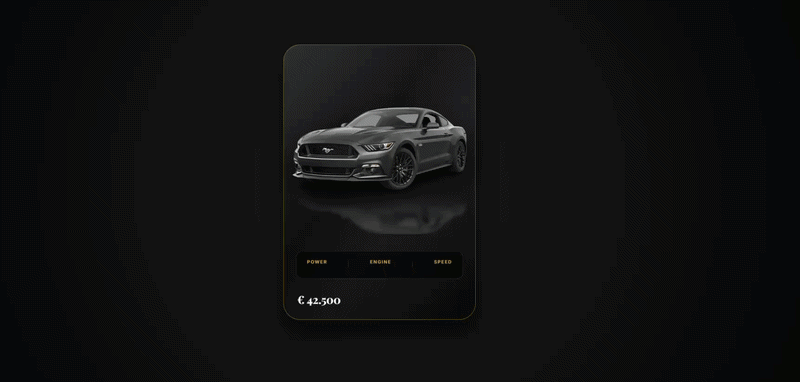

# 🚗 Mustang Luxury 3D Pop-Out Card

Un componente UI di fascia alta, interattivo e moderno, progettato per showcase automobilistici. Questa card sfrutta le trasformazioni 3D del CSS per creare un effetto di profondità dove l'auto sembra "uscire" dallo schermo al passaggio del mouse.



## ✨ Caratteristiche Principali
- **Effetto Pop-Out 3D:** L'auto si solleva e si sposta oltre i bordi della card grazie a `perspective` e `translateZ`.
- **Interazione Dinamica:** Effetto "Shine" (bagliore) che attraversa la card e rotazione dello sfondo al passaggio del mouse.
- **Dettagli Luxury:** - Riflesso specchiato dinamico sotto l'auto.
  - Ombra di contatto dorata (`gold-glow`).
  - Dashboard delle specifiche in stile *Glassmorphism* con sfocatura dello sfondo.
- **Tipografia Ricercata:** Utilizzo di *Playfair Display* per un look editoriale e *Inter* per le informazioni tecniche.
- **Totalmente Responsive:** La card si adatta e si scala fluidamente per dispositivi mobile.

## 🚀 Tecnologie Utilizzate
- **HTML5:** Struttura semantica.
- **CSS3 Puro:** - Variabili CSS (`:root`) per una facile personalizzazione.
  - Flexbox per il layout.
  - Trasformazioni 3D e animazioni `cubic-bezier`.
- **Google Fonts:** Integrazione font esterni.

## 🛠️ Vederla e usarla

- **Online:** [giuseppepentrelli.github.io/components/cards/cars-card/](https://giuseppepentrelli.github.io/components/cards/cars-card/), oppure nella [vetrina dei componenti](https://giuseppepentrelli.github.io/components/).
- **In un'altra pagina**, con un iframe:

```html
<iframe src="https://giuseppepentrelli.github.io/components/cards/cars-card/"
        title="Cars Card" loading="lazy" style="border:0; width:100%; height:660px"></iframe>
```
